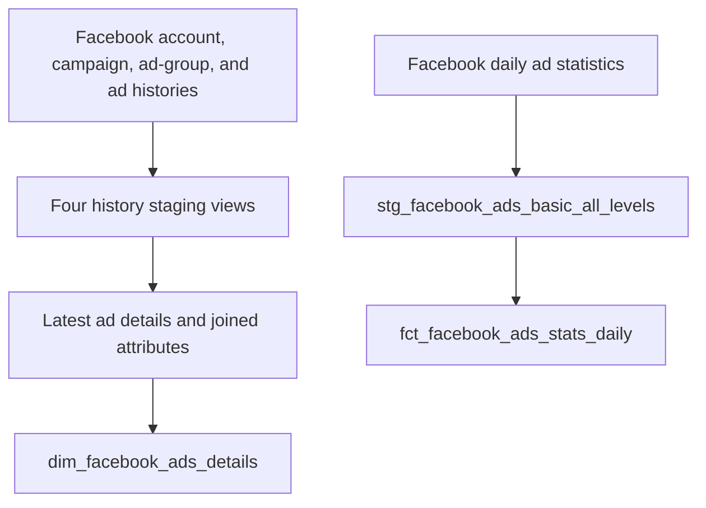

# Advertising Data Modelling

A dbt and Databricks project for preparing advertising data for analysis. The current implementation transforms Facebook advertising tables into a current ad-details dimension and an ad-level daily statistics fact table.

**Status: work in progress. Facebook models are implemented in SQL; Snapchat data and models are still to be added.** The intended direction is consistent reporting across advertising platforms. Cross-platform reporting is not implemented yet.

## Current scope

| Component | Current status |
| --- | --- |
| Facebook source definitions | Five tables declared; data must already exist in Databricks |
| Staging | Five views for accounts, campaigns, ad groups, ads, and daily statistics |
| Intermediate layer | One table joining the latest account, campaign, ad-group, and ad attributes |
| Reporting marts | Incremental ad-details dimension and daily statistics fact |
| Data quality | Uniqueness, non-null, and channel-value tests declared in model YAML |
| Snapchat | Planned; no Snapchat source definitions, models, or datasets are included |
| Ingestion, orchestration, and dashboards | Not included in this repository |

SQL and test definitions describe the implementation; they are not evidence that a warehouse build or its tests have passed. Raw datasets and warehouse credentials are not distributed with this project.

## Data flow



The two marts can be joined on `ad_id`. The dimension holds current attributes, so joining it to older facts does not reconstruct historical campaign or ad names.

## Technology

- Python 3.12 or later and [uv](https://docs.astral.sh/uv/) for the local environment.
- `dbt-databricks >=1.12.7` for transformations on Databricks.
- `dbt_utils`, Elementary, and `dbt_expectations` declared as dbt packages.
- SQL and YAML for model logic, configuration, and tests.

Exact dependency declarations and package locks are described in the [setup guide](docs/SETUP.md).

## Getting started

Clone the repository and install the locked Python dependencies from the repository root:

```bash
git clone https://github.com/Abduls100/adverts_modelling.git
cd adverts_modelling
uv sync --locked
```

Follow [Setup and running the project](docs/SETUP.md) to create a development profile outside the repository, supply a local `.env`, and check access to the five source tables. The committed `ads_marketing/profiles.yml` has unresolved configuration issues; the guide supplies a separate minimal development profile.

After completing that configuration, run these commands from the repository root:

```bash
uv run --locked --env-file .env dbt deps --project-dir ads_marketing --profiles-dir "$HOME/.dbt-adverts"
uv run --locked --env-file .env dbt debug --project-dir ads_marketing --profiles-dir "$HOME/.dbt-adverts" --target dev
```

For the initial historical build, use a development catalog and schema that you own. This command rebuilds the selected marts and their upstream models:

```bash
uv run --locked --env-file .env dbt build --project-dir ads_marketing --profiles-dir "$HOME/.dbt-adverts" --target dev --full-refresh --select +dim_facebook_ads_details +fct_facebook_ads_stats_daily
```

The fact model starts ordinary non-production microbatches at the current timestamp. An ordinary development build may therefore exclude older source records; see [load behavior](docs/DATA_MODEL.md#incremental-load-behavior) before interpreting an empty result.

## Repository guide

| Path | Purpose |
| --- | --- |
| `pyproject.toml`, `uv.lock` | Python dependencies and the root environment lock |
| `ads_marketing/dbt_project.yml` | dbt paths, materializations, and output namespaces |
| `ads_marketing/models/staging/facebook/` | Facebook source declarations, casts, and model tests |
| `ads_marketing/models/intermediate/facebook/` | Latest-record selection and descriptive joins |
| `ads_marketing/models/marts/` | Ad-details dimension and daily statistics fact |
| `ads_marketing/macros/` | Namespace overrides and work-in-progress SQL helpers |
| `ads_marketing/packages.yml`, `ads_marketing/package-lock.yml` | dbt package declarations and resolved versions |
| `ads_marketing/analyses/`, `ads_marketing/seeds/`, `ads_marketing/snapshots/`, `ads_marketing/tests/` | Placeholder directories; model YAML currently contains the data tests |
| `docs/` | Setup, data model, development notes, and the Snapchat integration plan |

## Documentation

- [Setup, credentials, commands, and troubleshooting](docs/SETUP.md)
- [Source requirements, model dictionary, tests, and load behavior](docs/DATA_MODEL.md)
- [Development workflow, known limitations, and Snapchat roadmap](docs/DEVELOPMENT.md)
- [dbt project overview](ads_marketing/README.md)

## Important boundaries

- Ingestion is external: dbt expects the Facebook tables to exist already.
- Raw source locations are hard-coded in `sources.yml`; selecting `dev` changes output placement, not the input catalog.
- The fact model selects existing daily rows; it does not aggregate intraday records or remove duplicates.
- Currency and account identifiers are not retained in the final fact, and currency is not retained in the dimension. Cross-account or cross-platform spend totals require currency validation before use.
- Source freshness, non-development profiles, and observability configuration still need validation. See the [development notes](docs/DEVELOPMENT.md#known-limitations-and-follow-up-work).

## Contributing

Create a focused branch from the latest `main`, make and validate the change, then open a pull request. When Snapchat is added, update the source requirements, lineage, tests, and status statements together. Keep local credentials and Git backup folders outside version control.

No license file is currently included in this repository.
